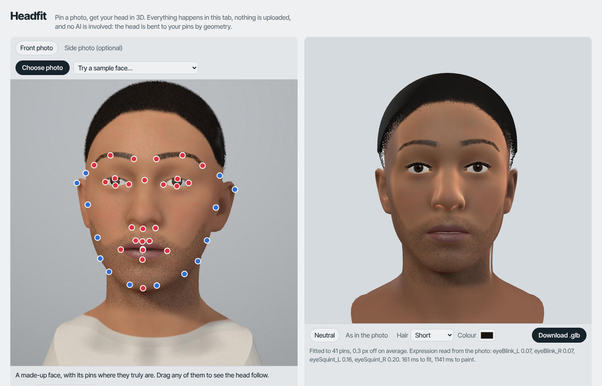

# Headfit

A 3D head from a photo, in the browser, without AI. You drag pins onto a photo (eye corners, nose, mouth, jaw,
ears); a ready-made head is bent so its matching spots land on your pins; the photo is then laid onto its skin.
Nothing is uploaded, and no neural network or learned face model is involved.



## Run it

```bash
python3 -m http.server 8790
```

Open <http://localhost:8790/web/>. Try a sample face, or choose a photo: click the middle of each eye and the mouth,
then drag the 41 pins onto their spots. The six samples are made up, not photos of anyone: `src/synth.js` bends
the head by a known amount, paints its skin (uneven tone, blush, freckles, stubble, brows, lips), and lights and
draws it like a studio portrait: a soft key light with shadows, light scattering under the skin, sheen, wet eyes
under relaxed lids, and hair drawn strand by strand, cropped on three of them and long on the other three (long
hair covers the ears, so those samples leave the ear pins out).

Red pins are spots; blue pins slide along an outline (the jaw line, the rim of an ear), so only how far out they
sit matters. A side photo is optional. **Download .glb** saves the head (metres, textures included).

Tests and checks need Node 22:

```bash
npm install
npm test
node tools/eval_synthetic.mjs 20 2
```

## How it works

1. **The head.** ICT's Face Model Light: a 26,719-vertex head with neck, eyes, teeth and lashes, and 53 ARKit
   expression shapes (an animation rig). `tools/pack_ict.py` packs it into 3.9 MB. ICT's 100 identity shapes are
   left out: they are learned from scans, and this project stays with geometry.
2. **A camera per photo** (`src/camera.js`): a pinhole camera posed by least squares so the template's spots fall
   on the pins. "Taken by someone else" puts it 1.2 m away; "at arm's length" 45 cm.
3. **The bend** (`src/fit.js`, `src/warp.js`): every pin becomes a ray from the camera; the spot on the head is
   moved onto its ray (onto both rays, with a side photo). Outline pins pick the outermost vertex at their height;
   jaw pins slide along ICT's jaw line. A 3D thin-plate spline carries those moves to the whole head, while
   anchors keep the back of the head and the neck in the template's shape.
4. **The expression** (`fitHead`, step 3): smile, upper lip, blink and squint weights are read from the mouth and
   lid pins by non-negative least squares on ICT's ARKit shapes; the jaw's opening from the gap between the lips.
   The head is shown with them taken out ("Neutral"), or as in the photo.
5. **The skin** (`src/bake.js`): each texel of the skin's UV layout is found on the fitted head, checked against a
   depth buffer of each photo, and given the photo's colour, weighted by how squarely it faces the camera. The
   photo's lighting is divided out (brightness modelled as ambient plus one soft light over the normals), the
   plain backdrop is kept off the edges, the neck fades to skin tone below the chin, and what no photo sees gets
   the skin's tone.
6. **Hair** (`src/hair.js`, `src/strands.js`): close-cut styles are a shell over the scalp (shaved, buzz cut,
   short, full on top). Longer styles (bob, shoulder length, long, long and wavy) are about 12,000 strands grown
   on the fitted head: rooted at random spots on the scalp, combed away from a parting, pulled down by gravity,
   and kept outside the head, neck and shoulders and out of the face by a few ellipsoids measured from the head.
   Hair is tinted from the photo above the forehead.

Fitting takes about 0.1 s and painting about 1 s, in a worker.

## How well it does

Measured on made-up heads (`tools/eval_synthetic.mjs`): the template bent by a known, smooth amount, some of them
smiling, drawn to 900 px photos, with the pins where they truly are plus 2 px of hand-placing error. Because the
true shape is known, the error is in millimetres (root mean square over the front of the face, after lining up).
20 heads:

| | template | fitted, camera estimated | fitted, camera known |
|---|---|---|---|
| face shape error | 1.69 mm | 1.56 mm | 1.28 mm |

- **Hidden pins** (one left out at a time; how far the fitted head puts that spot, as % of eye width): 1.9 % for
  the template posed by the same camera, 0.9 % fitted. The chin goes from 3.0 to 1.1 %, the outer eye corner from
  2.8 to 0.6 %.
- **Smile**: a smile of 0.5 reads back as 0.31 on average, and no smile as 0.01. Pin error and the bend both
  soak up part of a smile.
- **One photo** can't tell a slightly wrong tilt of the camera from a different depth of face, which is most of
  the gap between the last two columns. With a side photo too, the cameras are posed again on the bent head a
  few times.

Made-up heads are smoother than real ones, so these numbers flatter the method. With every pin in place, the
fitted head meets the pins to within about 2 pixels.

## Not done yet

- Better long hair: it is drawn as one-pixel lines in the 3D view with no shadows of its own, it hangs straight
  beside the face from every angle, and there are no fringes, curls or tied-back styles.
- Side photos: the code path exists but has no samples or measured results yet.
- Reading a smile fully (0.5 reads as 0.31).
- Made-up faces that pass for photos: they still read as computer-drawn. More varied face shapes and skin detail
  from openly licensed texture photos would help.
- Posing the camera and bending the face together (the pose that needs the least bending), to help one-photo depth.
- Saving heads in the browser between visits.

## Layout

- `src/` the engine, plain ES modules shared by the page and Node: `head.js`, `pins.js`, `camera.js`, `warp.js`,
  `fit.js`, `start.js` (first guesses from three clicks), `bake.js`, `raster.js`, `hair.js`, `strands.js`, `synth.js` (made-up
  faces), `linalg.js`
- `web/` the page: `index.html`, `app.js`, `worker.js`, `style.css`, samples, vendored three.js
- `data/` the packed ICT head
- `tools/` packing the head, making the samples, the accuracy check, Node helpers
- `test/` `node --test`

Licence: MIT ([LICENSE](LICENSE)). Credits for the head data, three.js and the font: [CREDITS.md](CREDITS.md).
